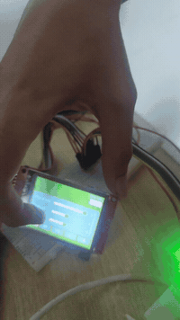
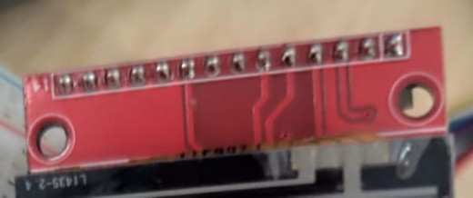
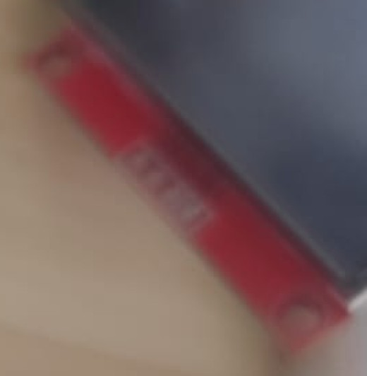
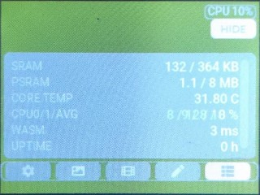
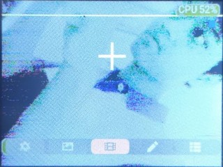
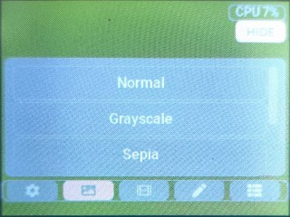
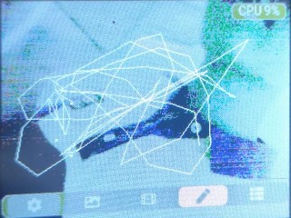
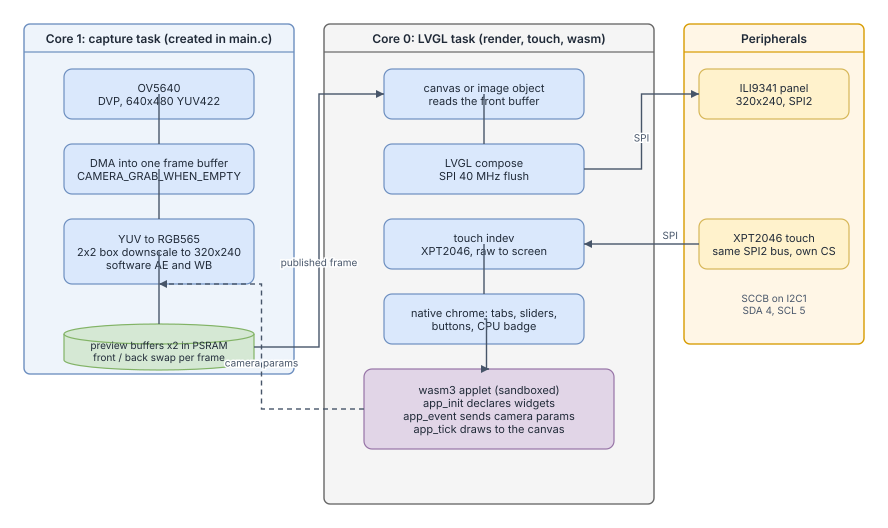

[](https://github.com/fariswirakusuma/dalangs_TFT/actions/workflows/firmware.yml)


# dalangs_TFT

A touch-screen camera tuner and a small Wasm UI playground for the ESP32-S3.
The native layer owns the display, touch, camera, and chrome. Each applet is a
tiny freestanding `.wasm` module that declares its controls or draws to a canvas.

Built with **ESP-IDF v6.1 + CMake + Ninja + LVGL 8.4 + wasm3**.



## Status

Pre-release `0.1.0`: the UI, touch, Wasm applets and camera tuning work; the
camera preview is usable but noisy, and the details are in
[Known issues](docs/KNOWN_ISSUES.md).

| Part | State |
| --- | --- |
| #3 Touch-screen camera tuner | Implemented: live preview, three sliders, four effects, reset |
| #4 Wasm UI switcher and profiler | Implemented: five applet tabs, live/draw/bench applets, live CPU badge |
| Camera preview | Works, but noisy in dim light and colour-shifted by a strongly coloured scene: [Known issues](docs/KNOWN_ISSUES.md) |
| Host tests and firmware build | Passing, enforced by CI |
| On-board validation | Manual checklist in [docs/TESTING.md](docs/TESTING.md) |

## Hardware

- **Board**: ESP32-S3-CAM N16R8, dual USB-C, onboard microSD and camera FPC.
- **MCU**: ESP32-S3-WROOM-1 **N16R8** (16 MB flash, 8 MB octal PSRAM).
- **Camera**: OV2640/OV3660/**OV5640** DVP module. OV5640 uses the same DVP
  wiring as OV2640, so no pin change is needed for the 5 MP sensor.
- **Display**: 2.8 inch 240x320 SPI TFT, ST7789 or ILI9341 controller.
- **Touch**: XPT2046 resistive controller on the same SPI bus.
- **Power**: 3.3 V logic. Tie the TFT LED pin to 3.3 V through the module
  backlight circuit. The onboard microSD (GPIO 38-40) and WS2812 (GPIO 48) are
  left unused by this firmware.

The display uses the board's own SPI LCD header: SCL=IO42, SDA=IO41,
RES=IO0 (shared with BOOT), DC=IO45, CS=IO47, BLK=IO21. The XPT2046 adds T_CS=IO1 and T_DO=IO14;
its CLK/DIN share the LCD header. The exact wiring is in
[docs/HARDWARE.md](docs/HARDWARE.md). All GPIO numbers live in
[`main/include/pins.h`](main/include/pins.h).

| TFT module front | TFT module back |
| --- | --- |
|  |  |
| 2.8 inch 320x240 SPI panel on the board's LCD header | FPC tail and the touch controller pads |

## Screens

| | |
| --- | --- |
|  |  |
| BENCH: memory, core temperature, CPU per core, Wasm load time | LIVE: camera preview with the touch crosshair |
|  |  |
| FX: presets, the active one stays highlighted | DRAW: canvas applet over the preview |

## Quick start

Requirements:

- ESP-IDF **v6.1** installed and exported (`$IDF_PATH`).
- `cmake`, `ninja`, `make`, `git`.
- Optional: `clang` with the `wasm32` target and `wasm-ld` to rebuild applets.

```sh
git clone --recurse-submodules git@github.com:fariswirakusuma/dalangs_TFT.git
cd dalangs_TFT

make setup            # submodules, managed components, target esp32s3
make build
make flash            # PORT=/dev/ttyACM0 by default
make monitor
```

Override the serial port:

```sh
make flash PORT=/dev/ttyUSB0
```

If the clone was made without submodules:

```sh
git submodule update --init --recursive
```

## Controls

Five tabs run along the bottom of the 320x240 landscape screen.

| Tab | Applet | What it does |
| --- | --- | --- |
| `SLIDERS` | `basic_sliders.wasm` | Brightness, contrast, saturation sliders (`-2..2`) |
| `FX` | `fx_buttons.wasm` | Normal, Grayscale, Sepia, Negative, Reset |
| `LIVE` | `live_cam.wasm` | Camera view with a wasm-drawn crosshair and recording dot |
| `DRAW` | `draw_pad.wasm` | Touch drawing pad over the camera |
| `BENCH` | native + `bench.wasm` | Live SRAM/PSRAM usage, core temperature, wasm load time, uptime |

The top status bar is native C and shows free internal SRAM, free PSRAM, and the
last Wasm load time in milliseconds.

## How it works



The diagram above is generated from an editable draw.io file:
[`docs/diagrams/architecture.drawio`](docs/diagrams/architecture.drawio). Open it
in [draw.io](https://app.diagrams.net) to change the pipeline, then refresh the
image with `python3 scripts/drawio_to_svg.py docs/diagrams/architecture.drawio
docs/images/architecture.svg`.

Capture runs on core 1: the sensor fills a VGA YUV422 frame, `camera_tuner`
converts it to RGB565, averages it down 2x2 to 320x240 and publishes it into one
of two PSRAM buffers. Core 0 owns everything a user sees: LVGL composites that
frame, the touch panel drives tabs, sliders and buttons, and each applet is a
wasm3 module that declares widgets at init, receives events, and draws to the
canvas in its tick. Camera parameters set from an applet are applied through the
sensor's SCCB bus.

The firmware embeds five small `.wasm` binaries. wasm3 parses and instantiates
the selected module, links a fixed host ABI, and calls `app_init`. Switching
tabs frees the old runtime before loading the next module.

## Repository layout

```text
.
├── main/
│   ├── include/        public headers, pins.h is the wiring source of truth
│   ├── src/            board, camera, UI, wasm host, system monitor
│   ├── wasm/           freestanding applet sources and committed .wasm files
│   └── main.c
├── components/wasm3/   thin ESP-IDF wrapper around third_party/wasm3
├── third_party/wasm3/  pinned submodule
├── test/               host unit tests and wasm binary validation
├── docs/               hardware, architecture, ABI, testing, git workflow
├── .github/workflows/  firmware build, host tests, docs lint
└── Makefile            build/flash/monitor/clean controller
```

## Wasm applets

```sh
make wasm
```

The script compiles with `clang --target=wasm32 -nostdlib`, uses `wasm-ld`, and
writes the result next to the source. The ABI is documented in
[docs/WASM_ABI.md](docs/WASM_ABI.md).

Committed `.wasm` files are build inputs for the firmware, so they are tracked
on purpose.

## Tests

```sh
make test
make lint-ui
make touch-debug    # log raw/mapped touch coordinates
make wasm-smoke     # load every applet once at boot
```

This runs host-side unit tests for camera parameter clamping and the widget
model, then validates every committed wasm binary's imports and exports. No
board is required. Hardware checks are in [docs/TESTING.md](docs/TESTING.md).

## Limitations

- ST7789 vs ILI9341 must match the panel. The default is **ILI9341**. Select the
  other one in `menuconfig` under `dalangs_TFT -> LCD controller`. Wrong choice
  usually means a blank or noisy screen, not a crash.
- The XPT2046 needs per-board calibration; defaults are only a starting point.
- The camera preview uses a single buffer. Heavy load can tear the image; this is
  acceptable for a tuner, and the upgrade path is documented in the source.
- No Wi-Fi, SD card, or OTA. Applets are embedded in the firmware.
- `third_party/wasm3` is a submodule; recursive clone is required.

## Documentation

- [Hardware and wiring](docs/HARDWARE.md)
- [Known issues](docs/KNOWN_ISSUES.md)
- [Release and rollback](docs/RELEASE.md)
- [Architecture](docs/ARCHITECTURE.md)
- [Wasm ABI](docs/WASM_ABI.md)
- [Testing](docs/TESTING.md)
- [Git workflow](docs/GIT_WORKFLOW.md)
- [Credits](docs/CREDITS.md)
- [Contributing](CONTRIBUTING.md)

## License

See [LICENSE](LICENSE). Third-party components keep their own licenses; the
ones this firmware relies on are listed in [docs/CREDITS.md](docs/CREDITS.md).
