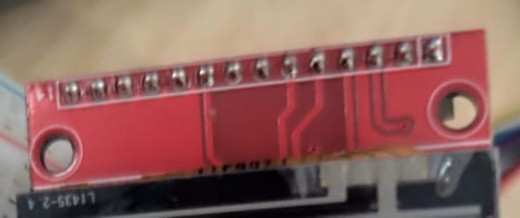
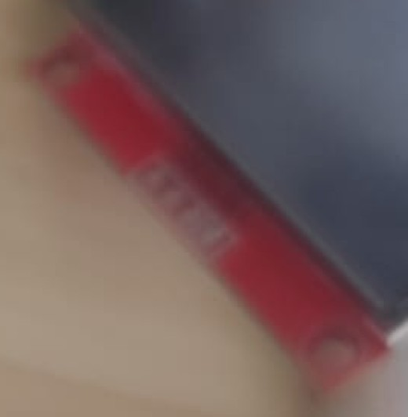

# Hardware



## Board

- **Board**: ESP32-S3-CAM N16R8, dual USB-C, onboard microSD and camera FPC.
- **MCU**: ESP32-S3-WROOM-1 N16R8 (16 MB flash, 8 MB octal PSRAM).
- **Camera**: OV2640 / OV3660 / OV5640 DVP module. OV5640 uses the same DVP
  wiring, so no pin change is needed for the 5 MP sensor.
- **Display**: 2.8 inch 240x320 SPI TFT, ST7789 or ILI9341.
- **Touch**: XPT2046 resistive controller.

The default is **ILI9341** for this 2.8 inch module. Some modules use
**ST7789** instead; confirm the controller before blaming the firmware. The
driver is selected at build time:

```sh
make lcd-ili9341    # this build
make lcd-st7789     # only if your panel is actually ST7789
make build flash monitor
```

Or use `make menuconfig` under `dalangs_TFT -> LCD controller`.

## Pin map

All values are in [`main/include/pins.h`](../main/include/pins.h). Change them
there and update this table in the same commit.

### Display (SPI2 / FSPI)

| Signal | GPIO | Notes |
| --- | --- | --- |
| SCK | 42 | Board LCD header `SCL`; shared with XPT2046 `T_CLK` |
| MOSI (SDA) | 41 | Board LCD header `SDA`; shared with XPT2046 `T_DIN` |
| MISO | 14 | Touch `T_DO`; LCD MISO is optional |
| CS | 47 | Board LCD header `CS` |
| DC | 45 | Board LCD header `DC` |
| RST | 0 | Board LCD header `RES`; shared with BOOT |
| BL | 21 | Board LCD header `BLK` |

### Touch (XPT2046)

| Signal | GPIO | Notes |
| --- | --- | --- |
| T_CS | 1 | QWIIC SDA pin, used as touch chip select |
| T_IRQ | -1 | Not used; the driver polls over SPI |
| T_CLK | 42 | Shared with LCD SCK |
| T_DIN | 41 | Shared with LCD MOSI |
| T_DO | 14 | Shared with LCD MISO |

## Board back



## Camera (DVP)

| Signal | GPIO | Signal | GPIO |
| --- | --- | --- | --- |
| XCLK | 15 | VSYNC | 6 |
| SIOD (SDA) | 4 | HREF | 7 |
| SIOC (SCL) | 5 | PCLK | 13 |
| D0 | 11 | D4 | 12 |
| D1 | 9 | D5 | 18 |
| D2 | 8 | D6 | 17 |
| D3 | 10 | D7 | 16 |
| PWDN | -1 | RESET | -1 |

`PWDN` and `RESET` are tied off on the common camera module.

### 2.8 inch 14-pin module to the board

The board's LCD header is 8 pins. Wire the red 14-pin module like this:

| TFT module pin | ESP32-S3-CAM pin | Note |
| --- | --- | --- |
| VCC | 3V3 | 3.3 V only |
| GND | GND | Common ground |
| CS | IO47 | LCD chip select |
| RESET | IO0 | Board LCD header `RES`; shared with BOOT |
| DC | IO45 | Data/command |
| MOSI / SDI | IO41 | LCD header SDA |
| SCK | IO42 | LCD header SCL |
| LED | IO21 | Backlight control |
| MISO | IO14 | Optional LCD read; also touch T_DO |
| T_CLK | IO42 | Shared with LCD SCK |
| T_CS | IO1 | Touch chip select |
| T_DIN | IO41 | Shared with LCD MOSI |
| T_DO | IO14 | Shared with LCD MISO |
| T_IRQ | — | Not connected; polling is used |

Do not connect the touch and LCD MISO outputs to different pins and then wire
both to IO14 by mistake; they are one shared SPI MISO line.

## Board pins and conflicts

| GPIO | Why to avoid |
| --- | --- |
| 19, 20 | Native USB D-/D+ |
| 26-32 | SPI flash |
| 33-37 | Octal PSRAM on N16R8 |
| 38, 39, 40 | Onboard microSD (SD_CMD, SD_CLK, SD_D0) |
| 43, 44 | UART0 console |
| 45 | LCD DC on this board (also a strapping pin) |
| 46 | Shutter button |
| 0 | BOOT button / LCD RES (shared, by design) |
| 3 | User switch |
| 48 | Onboard WS2812 RGB LED |

GPIO 39-42 are also JTAG pins. This build uses 41 and 42 for the LCD/touch SPI
bus, so an external JTAG probe cannot be used at the same time. The UART0
console on 43/44 is untouched and remains available over the UART USB-C port.

## Power and signal notes

- The panel and XPT2046 are **3.3 V** devices. Do not apply 5 V to logic pins.
- Backlight current depends on the module. The 2.8 inch modules normally have a
  backlight transistor on the LED pin; if yours exposes the LED anode directly,
  add a transistor or a series resistor. A GPIO is a control signal, not a
  power source for a bare LED string.
- Keep the camera FPC away from the SPI clock line. Long unshielded wiring on
  PCLK, VSYNC, and HREF is the usual cause of a striped or missing preview.
- Use a short, solid ground return between the TFT module and the ESP32-S3.
- If the display works but touch does not, check `T_CS` and `T_DO` first. The
  touch controller shares SCK/MOSI with the display but has its own CS.

## Touch calibration

The driver is configured to pass raw 12-bit values through. `board_touch.c`
maps them to the panel and rotates them to landscape.

1. Flash a sketch or use the `DRAW` tab.
2. Touch each corner and note where the pointer lands.
3. Adjust in `pins.h`:
   - `TOUCH_RAW_X_MIN`, `TOUCH_RAW_X_MAX`
   - `TOUCH_RAW_Y_MIN`, `TOUCH_RAW_Y_MAX`
   - `TOUCH_SWAP_XY`, `TOUCH_MIRROR_X`, `TOUCH_MIRROR_Y`
4. Rebuild and repeat. Keep raw values inside `50..4045`.

## Display orientation

The UI is 320x240 landscape, rotated from the native 240x320 panel. The rotation
is applied by `esp_lvgl_port` from `LCD_LANDSCAPE`. If the image is upside down,
set `LCD_MIRROR_X` or `LCD_MIRROR_Y`; if the image is sideways, check that
`LCD_LANDSCAPE` is still `1`.


## Camera

The firmware requests `QVGA` (320x240) in `RGB565` with two PSRAM frame buffers.
This avoids JPEG decoding and matches the screen size. The sensor is detected by
PID and logged at boot. A missing camera does not crash the UI; the preview stays
black and the tuner still responds.

If the image is mirrored or upside down, change the `set_vflip` / `set_hmirror`
calls in `camera_tuner.c`. They are orientation settings, not wiring faults.

The preview is captured at VGA and averaged down to 320x240 in `camera_tuner.c`,
because the sensor's own QVGA scaler is noticeably soft.

The OV5640 on this board never applies its own auto exposure and its auto white
balance does not converge, so both are closed in software: the gain follows the
measured luma, and the red and blue channels are scaled until they match green.
There is no sensor preset to tune; correct the loops instead.
